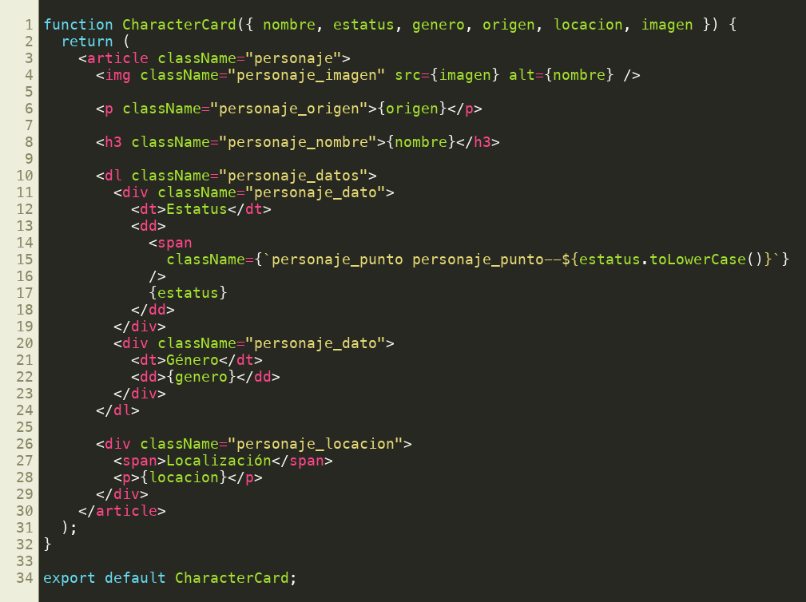
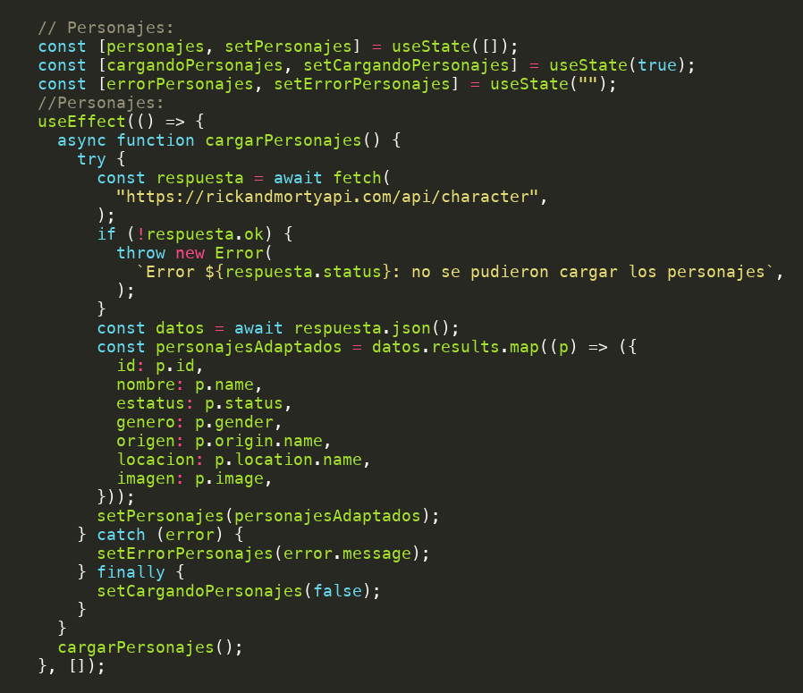
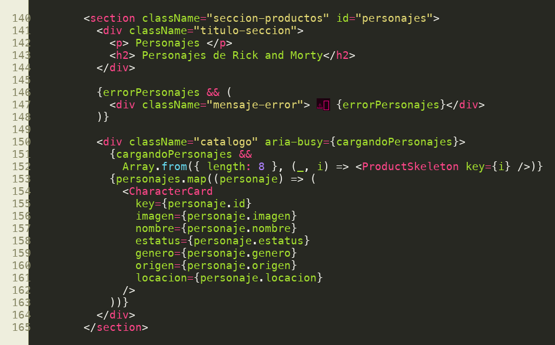
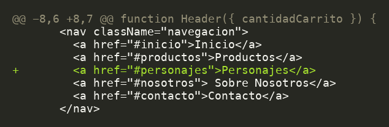
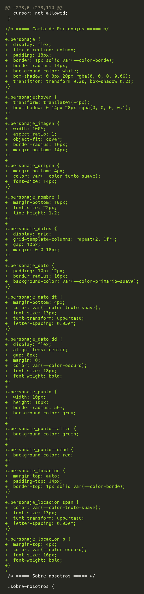

# Reporte: rama `feature/rickandmorty`

**Fecha:** 10 de noviembre de 2026
**Autor:** Atlost
**Rama base:** `main`
**Resumen:** se agregó una sección nueva, "Personajes de Rick and Morty", que carga personajes desde la API pública de Rick and Morty y los muestra en tarjetas.

**Archivos modificados:** 4 (207 líneas agregadas, 2 eliminadas)

| Archivo | Cambio |
|---|---|
| `src/components/CharacterCard.jsx` | **Nuevo**: componente de la tarjeta de personaje |
| `src/App.jsx` | Estado, llamada a la API y sección de personajes |
| `src/App.css` | Estilos de la tarjeta (`.personaje*`) |
| `src/components/Header.jsx` | Enlace "Personajes" en el menú |

## Historial de commits (del más antiguo al más reciente)

1. `a349717`: agregar el componente `CharacterCard`
2. `4960178`: cargar y mostrar personajes desde la API de Rick and Morty
3. `6d2abd8`: mejorar el estilo y la estructura de `CharacterCard`
4. `dee70ea`: editar los comentarios
5. `f52ccdb`: agregar el enlace a la sección de personajes en el encabezado
6. `178117e`: agregar la traducción de estatus y género en `CharacterCard`
7. `cdcc96b`: **revertir** el commit anterior. La traducción no quedó en el código final, así que los valores se muestran en inglés (`Alive`, `Dead`, `Male`…).

---

## 1. Componente `CharacterCard`

Componente que recibe los datos de un personaje por props y los muestra en una tarjeta. Incluye la imagen, el origen, el nombre, el estatus con un punto de color, el género y la localización.
El punto de color se obtiene a partir del estatus: `personaje_punto--alive` (verde), `personaje_punto--dead` (rojo) y, para `unknown`, el gris de la clase base.

## 2. Estado y llamada a la API (`App.jsx`)

Se agregaron tres estados: la lista de personajes, el indicador de carga y el mensaje de error. Un `useEffect` hace el `fetch` a `https://rickandmortyapi.com/api/character` una sola vez, al montar el componente. Luego adapta cada resultado a un objeto con nombres en español (`nombre`, `estatus`, `genero`, `origen`, `locacion`, `imagen`). El proceso sigue el mismo patrón `try / catch / finally` que ya se usaba para los productos.

## 3. Sección de personajes en la página (`App.jsx`)

La sección nueva tiene el id `#personajes`. Reutiliza las clases `seccion-productos` y `catalogo`, además del componente `ProductSkeleton`, que muestra 8 tarjetas de carga mientras llegan los datos. Si la petición falla, se muestra un mensaje de error.

## 4. Enlace en el encabezado (`Header.jsx`)

## 5. Estilos (`App.css`)

Las tarjetas se elevan al pasar el mouse por encima (hover). La imagen es cuadrada y los datos de estatus y género se acomodan en una cuadrícula de 2 columnas. La localización queda fija en la parte inferior de la tarjeta gracias a `margin-top: auto`.

---

## Observaciones

- La API devuelve los personajes en páginas, y solo se carga la primera, es decir, **20 personajes**. No hay paginación.
- La traducción de estatus y género se revirtió, así que la interfaz mezcla etiquetas en español con valores en inglés.
